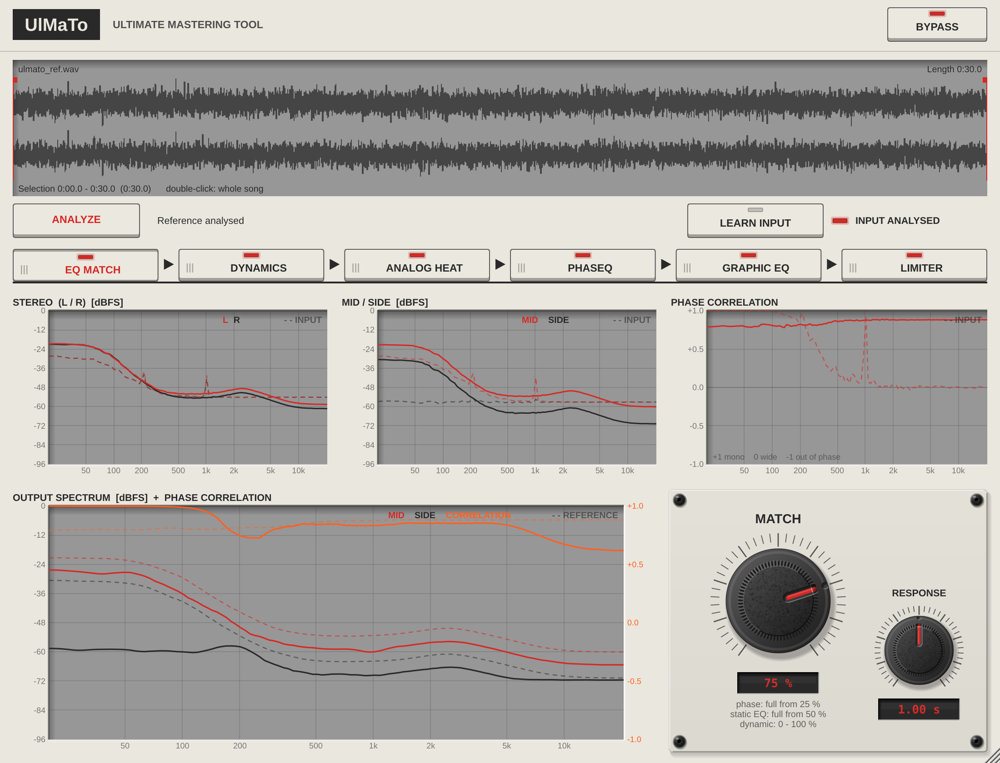
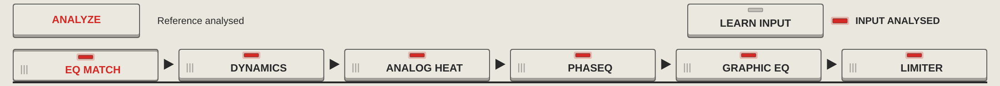
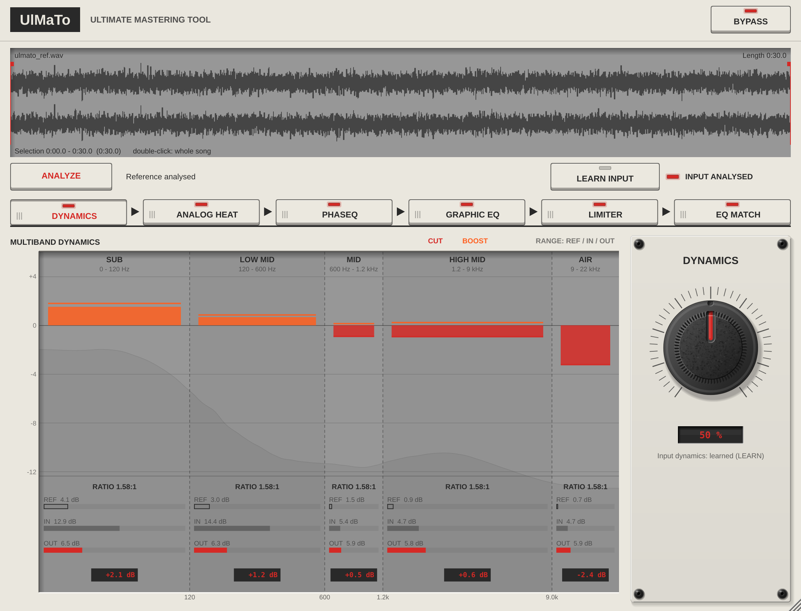
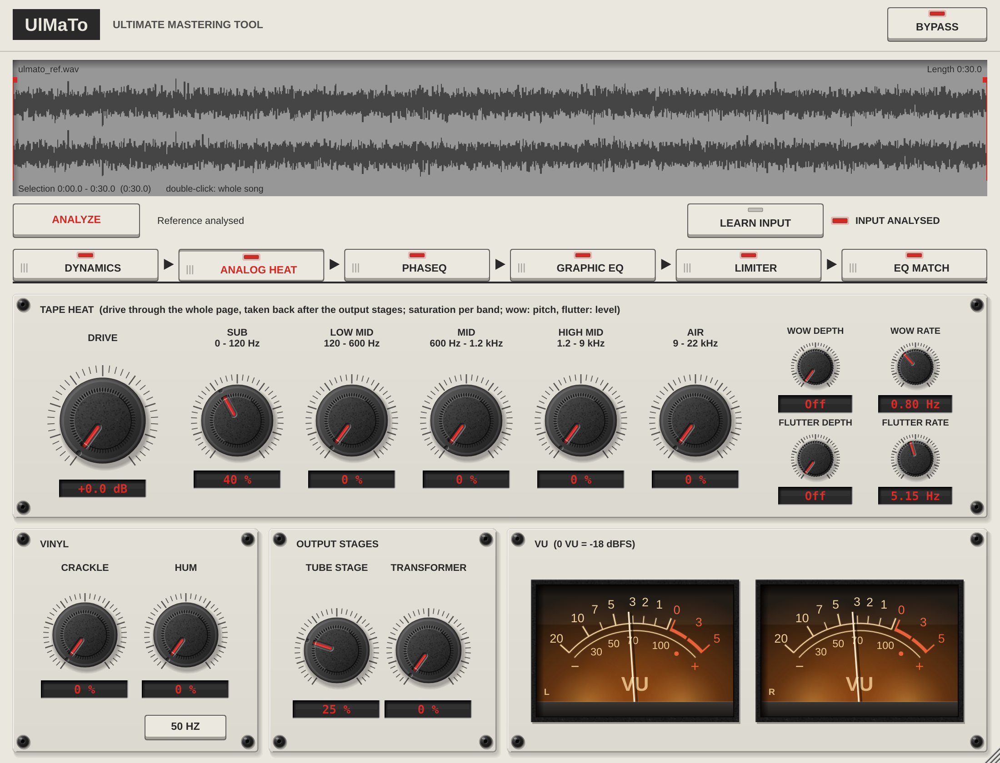
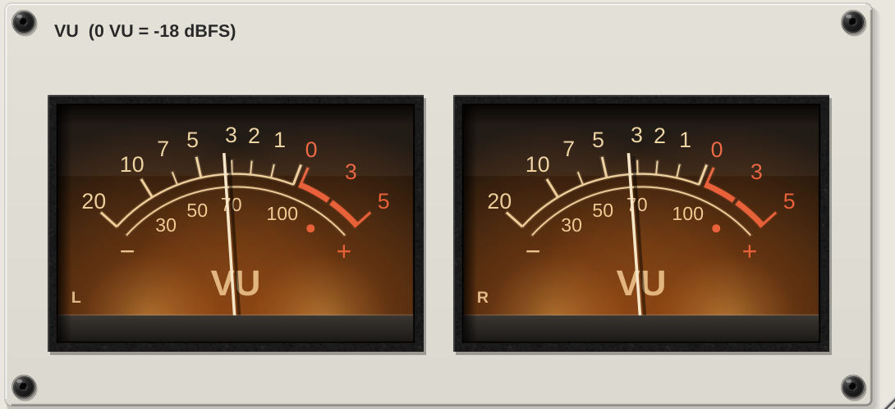
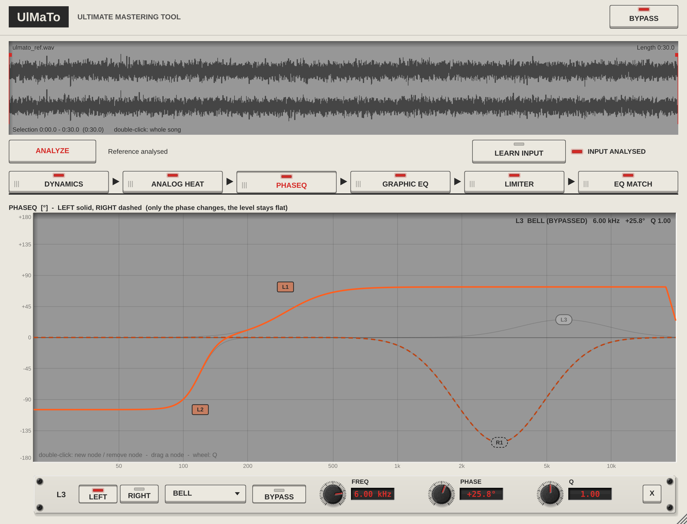
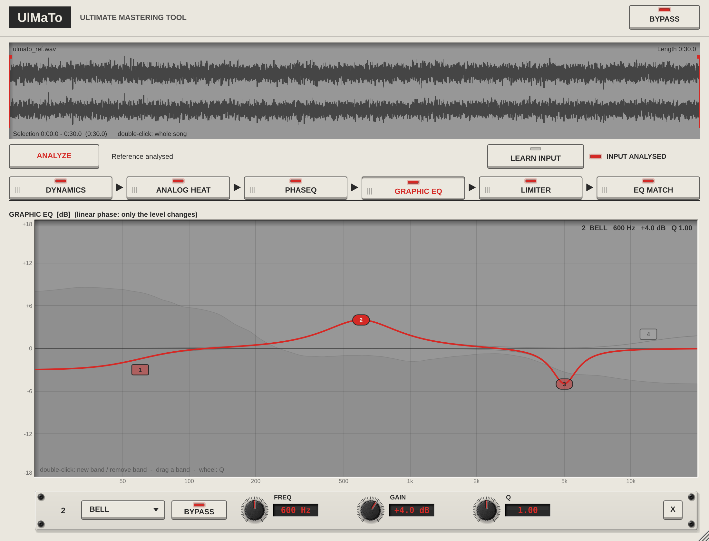
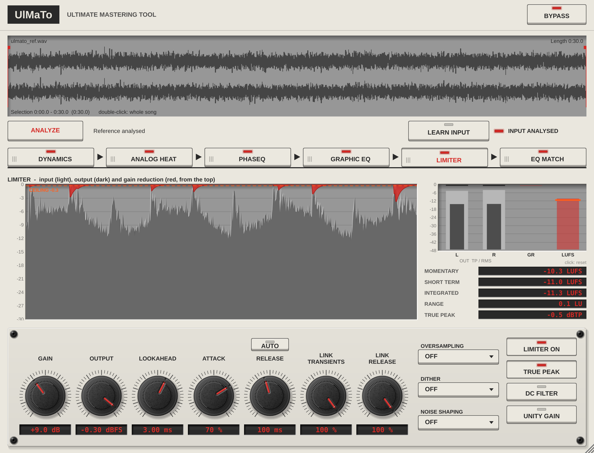

# UlMaTo – Ultimate Mastering Tool

UlMaTo is a VST3 mastering plugin built around **reference matching**. Drop in a reference song, and UlMaTo matches the tone, stereo image, phase and dynamics of your track to it, with linear-phase filters throughout. Around the matching sits a complete mastering chain of six stages, in any order you like:

**EQ MATCH · DYNAMICS · ANALOG HEAT · PHASEQ · GRAPHIC EQ · LIMITER**



---

## Features

- **Reference matching**
  - **Static part**: learned from your track (LEARN INPUT) and compared with the reference. It corrects the EQ of left and right, the phase between the channels, and the EQ of mid and side.
  - **Dynamic part**: follows the music in real time and corrects mid and side towards the reference. Bands that drop out or come back (a bass pause, say) are held, so nothing pumps or overshoots.
  - Both parts are combined into **one linear-phase 2×2 filter matrix**.
- **Multiband dynamics matching** in five bands: maps the dynamic range of each band to that of the reference, with upward compression, downward compression and expansion.
- **Analog heat**
  - Tape saturation per band, with automatic gain staging.
  - J37-style wow and flutter.
  - Vinyl crackle and mains hum.
  - Tube and transformer output stages.
  - Two backlit analog VU meters.
- **PhaseQ**: a phase-only EQ. Up to 12 nodes on the left or right channel; the level stays exactly flat.
- **Graphic EQ**: a linear-phase EQ with up to 12 bands (bell, low shelf, high shelf).
- **Mastering limiter**
  - Lookahead brickwall limiting with true peak and oversampling up to 8×.
  - Auto release, channel link, DC filter, dither with noise shaping.
  - BS.1770 loudness meters.
- **Free stage order**: drag the tabs to reorder the chain, and click a tab's LED to bypass that stage. The latency is the same in every order.
- **Hardware-style interface**
  - Raised, screwed panels, knurled knobs and LED buttons.
  - Recessed grey displays and LED value readouts.

---

## Workflow

1. **Load a reference**: drop a song (WAV, AIFF, FLAC, MP3, Ogg) onto the waveform at the top.
2. **Choose the range**: drag the two red markers to the part of the song that should serve as the reference, for example the chorus. Double-click to use the whole song.
3. Press **ANALYZE**. The reference is analysed (spectrum, stereo, phase, dynamics), and the status reads *Reference analysed*.
4. Play your track and switch on **LEARN INPUT** while the representative part plays. Switch it off afterwards; the **INPUT ANALYSED** LED lights up. The static correction and the dynamics ratios are now fixed.
5. Turn up **MATCH**. Up to 25 % the phase correction fades in, up to 50 % the static EQ, and the dynamic part follows the knob over the whole range. **RESPONSE** sets how fast the live analysis follows the music.
6. Finish with the other stages: dynamics, analog colour, phase, EQ and the limiter.

Without LEARN INPUT, only the dynamic part works, using the live input.

---

## The signal chain



The six tabs show the processing order from left to right.

| Action | Result |
|---|---|
| Click a tab | Shows that stage's page |
| **Drag** a tab | Moves the stage in the chain; the other tabs slide aside |
| Click the **LED** of a tab | Bypasses or activates the stage (a greyed tab is bypassed) |
| **BYPASS** (top right) | Bypasses the whole plugin, latency-compensated and cross-faded |

---

## Pages

### EQ match


- **Stereo (L / R)** and **Mid / Side**: the spectrum of the reference (solid) against your input (dashed), in dBFS.
- **Phase correlation**: correlation over frequency of the reference against the input. +1 means mono, 0 means wide, −1 means out of phase.
- **Output spectrum + phase correlation**: mid, side and correlation of the output, with the reference dashed.
- **MATCH** (0–100 %) sets the amount of the correction. **RESPONSE** (0.2–5 s) is the time constant of the live analysis.

### Dynamics



Five bands: **SUB** (0–120 Hz), **LOW MID** (120–600 Hz), **MID** (600 Hz – 1.2 kHz), **HIGH MID** (1.2–9 kHz) and **AIR** (9–22 kHz).

- Each band is measured as a level distribution: a centre level and a dynamic range (the 95th minus the 10th percentile). Quiet passages more than 20 dB below the band average are ignored, so breaks don't pull the centre down.
- The level is mapped around that centre. Where your track is more dynamic than the reference, it is compressed (upward and downward). Where it is flatter, it is expanded.
- The bars show the current gain (orange = boost, red = cut). Below them are the ratio and the range of reference, input and output.
- **DYNAMICS** (0–100 %) sets the amount. The stage has its own 10 ms lookahead.

### Analog heat



| Section | Controls |
|---|---|
| **TAPE HEAT** | **DRIVE** (0 … +24 dB) drives the whole page and is taken back after the output stages (automatic gain staging). Tape saturation per band (**SUB … AIR**, 0–100 %). **WOW** depth and rate (0.2–25 Hz, pitch) and **FLUTTER** depth and rate (1–50 Hz, level), modelled on the Abbey Road J37. |
| **VINYL** | **CRACKLE** (clicks and pops, each at its own place in the stereo field), **HUM** (mains hum with harmonics), switch **50 / 60 Hz** |
| **OUTPUT STAGES** | **TUBE STAGE** (asymmetric, even harmonics), **TRANSFORMER** (saturates mostly in the bass) |
| **VU** | Two analog VU meters, L and R, with 0 VU = −18 dBFS |

- The saturation runs 2× oversampled and stereo: the drive of each saturator is varied slightly per sample, separately for left and right.
- Only the **harmonics** are added: the fundamental is projected out again, so the tonal balance stays put.

<p align="center"></p>

### PhaseQ



A phase-only equaliser: it changes the phase over frequency while the magnitude stays exactly flat. It is useful for aligning left and right, or for steering the phase of single ranges.

- Up to **12 nodes**, each on the **LEFT** or **RIGHT** channel (named L1, L2 … and R1, R2 …).
- Each node is a **bell**, a **low shelf** or a **high shelf** of phase, with its own **FREQ**, **PHASE** (−180 … +180°) and **Q**.
- **Double-click** the display for a new node, and double-click a node to remove it. Drag a node to move it; the mouse wheel changes Q.
- The strip below the display edits the selected node: channel, shape, **BYPASS**, the knobs, and **X** to remove it.
- The left curve is solid and the right one dashed.

### Graphic EQ



A linear-phase EQ: only the level changes, never the phase.

- Up to **12 bands**: bell, low shelf or high shelf, with **FREQ** (20 Hz – 20 kHz), **GAIN** (±18 dB) and **Q** (0.2–8).
- It is operated like PhaseQ: double-click to add or remove a band, drag a band, wheel for Q, and a strip for the selected band with **BYPASS** and **X**.
- A smooth spectrum of the signal lies in the background.

### Limiter



A lookahead brickwall limiter with no overshoot. The display scrolls the input (light), the output (dark) and the gain reduction (red, from the top), with the ceiling as a dashed line.

| Control | Range | Description |
|---|---|---|
| **GAIN** | 0 … +24 dB | Input gain into the limiter |
| **OUTPUT** | −6 … 0 dBFS | Ceiling |
| **LOOKAHEAD** | 0.1 … 5 ms | Length of the lookahead window |
| **ATTACK** | 0 … 100 % | Shape of the gain ramp within the lookahead |
| **RELEASE** | 0 ms … 10 s | Release time; **AUTO** = fast after transients, slow while it keeps limiting |
| **LINK TRANSIENTS / LINK RELEASE** | 0 … 100 % | Channel link for the attack and for the release |
| **OVERSAMPLING** | Off, 2×, 4×, 8× | Oversampled limiting |
| **DITHER / NOISE SHAPING** | Off, 24/20/16 bit · Off, Basic, Optimized | Dither at the output |
| **LIMITER ON / TRUE PEAK / DC FILTER / UNITY GAIN** | on / off | Stage on, true-peak detection (when off, the meters show RMS), DC filter, listening at the input level |

The meters show output true peak and RMS (L/R, in the same bar), gain reduction, and loudness after ITU-R BS.1770: momentary, short term, integrated, loudness range and maximum true peak. Click the meters to reset them.

---

## How it works

- **Threads**: the audio thread hands the signal to an engine thread, which does the analysis, learning, correction and filter design about every 40 ms. New filters are handed back without locks and cross-faded.
- **Matching filter**: a frequency-sampled linear-phase FIR as a 2×2 matrix, so left and right can feed each other for the phase and mid/side correction. Both channels share one complex FFT.
- **PhaseQ and graphic EQ**: FIR stages designed from the curves, also linear phase.
- **Limiter**:
  - Per sample: the required gain (true peak detected with 8× interpolation and 32 taps).
  - A sliding minimum over the lookahead window, release with optional auto release, linked over the channels.
  - A ramp averaged over the attack part, so the gain reaches its target exactly at the peak.
  - A base-rate safety stage keeps true peak under the ceiling, even with oversampling.
- **Latency**: constant in every stage order. It is about 178 ms at 48 kHz, and the host compensates it.
- **CPU**: about 3.4 % of one core with the default settings, and 6.8 % with everything on (Release build, 48 kHz).

---

## Building

### Requirements

- CMake 3.22 or newer
- A C++20 compiler (developed with MSVC / Visual Studio 2022 on Windows)
- [JUCE](https://github.com/juce-framework/JUCE) 8, included as a git submodule in `libs/JUCE`

### Clone and build

```bash
git clone --recursive <repository-url> UlMaTo
cd UlMaTo
cmake -B build
cmake --build build --config Release --target UlMaTo_VST3
```

The plugin ends up in `build/UlMaTo_artefacts/Release/VST3/UlMaTo.vst3`. Copy it, or link it, into your VST3 folder (on Windows `C:\Program Files\Common Files\VST3`), for example as a junction from an administrator command prompt:

```bat
mklink /J "C:\Program Files\Common Files\VST3\UlMaTo.vst3" "<path-to-UlMaTo>\build\UlMaTo_artefacts\Release\VST3\UlMaTo.vst3"
```

> **Notes**
> - Close the DAW before building. A loaded plugin locks the file, and the linker then fails with LNK1104 / LNK1168.
> - Use **Release** (or **RelWithDebInfo**) for actual work. Debug builds are many times slower.

The CMake option `ULMATO_BUILD_PLUGIN_HOST` (on by default) also builds JUCE's AudioPluginHost for debugging. Turn it off with `-DULMATO_BUILD_PLUGIN_HOST=OFF`.

---

## Project structure

```
UlMaTo/
├── CMakeLists.txt
├── libs/JUCE/               JUCE (git submodule)
├── docs/                    screenshots for this README
└── source/
    ├── PluginProcessor.*    parameters, state, reference file, stage settings
    ├── PluginEditor.*       pages, layout and controls
    ├── MatchEngine.*        engine thread, matching, stage chain
    ├── MatrixConvolver.h    2×2 partitioned convolution (one complex FFT for both channels)
    ├── Spectrum.h           spectral analysis
    ├── Dynamics.h           band splitter, dynamics analysis and matching
    ├── Analog.h             tape, wow/flutter, vinyl, tube, transformer, VU level
    ├── ToneStages.h         PhaseQ and graphic EQ curves, FIR stage
    ├── Limiter.h            mastering limiter, true peak, loudness (BS.1770)
    ├── Views.h              displays, waveform, stage tabs, VU meters
    ├── ToneViews.h          PhaseQ, graphic EQ and limiter displays
    └── UlMaToLookAndFeel.h  knobs, LED buttons, value displays
```

---

## Tested with

- pluginval at strictness level 7
- Ableton Live (Windows, VST3)
